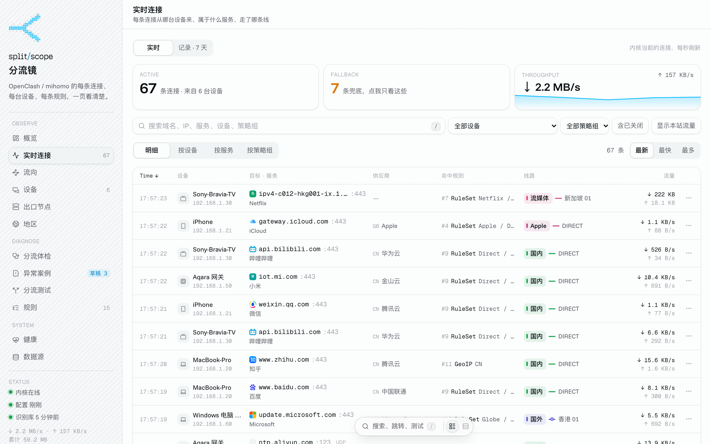
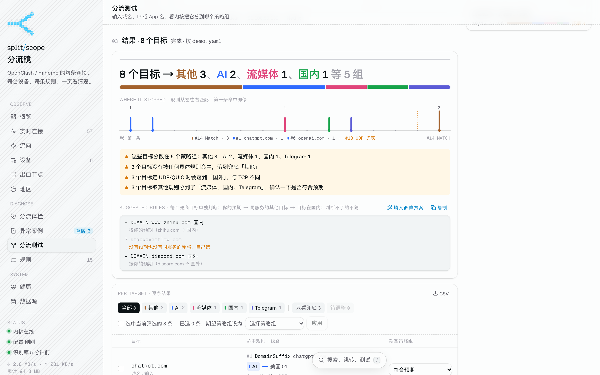
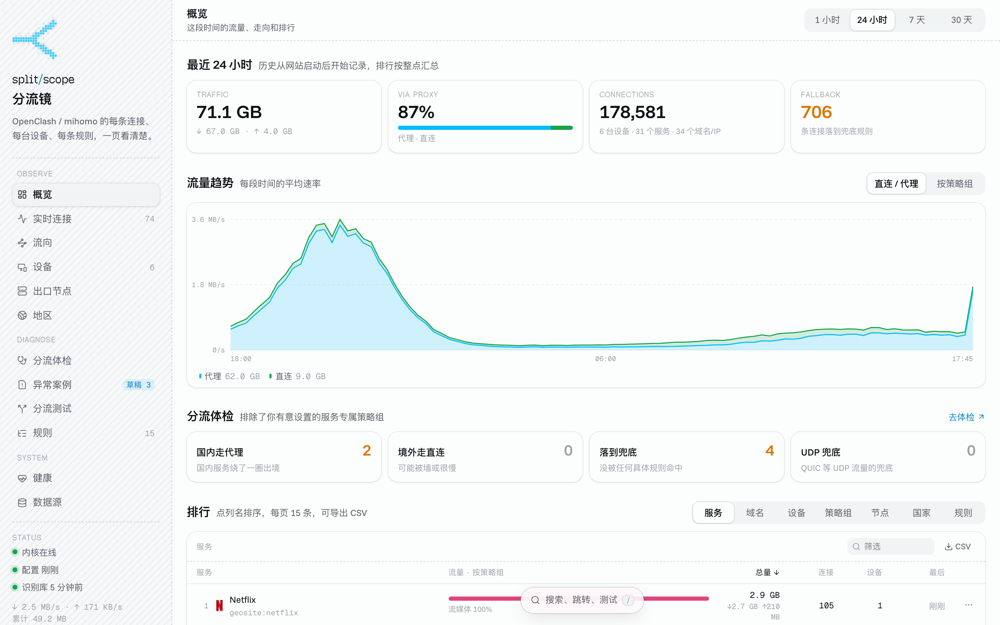
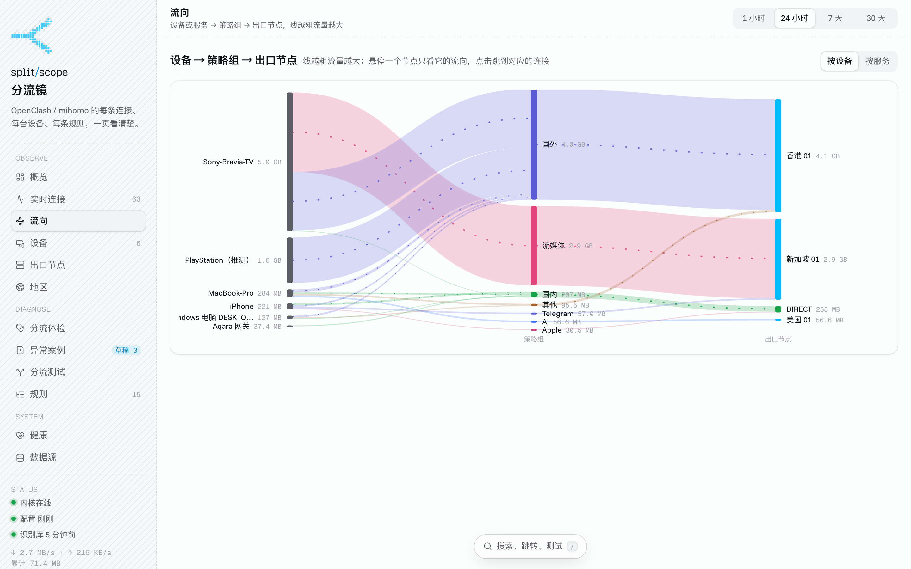
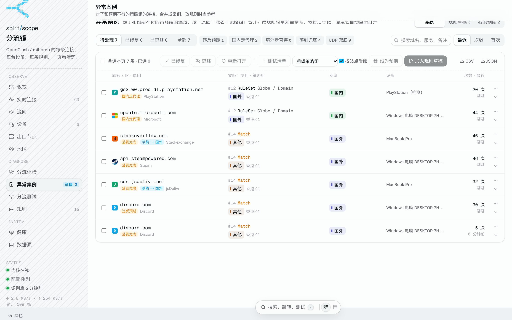
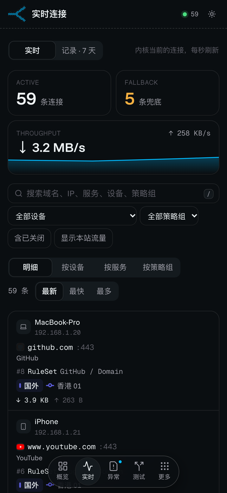

# 分流镜 · Splitscope

看清家里 OpenClash / mihomo 的每一条连接：**哪台设备、哪个网站或服务、命中了第几条规则、走了哪个策略组和节点**。再输入任意域名、IP 或 App 名（比如「支付宝」），让内核真实判定一遍它会被分到哪里。

> A self-hosted companion for OpenClash / mihomo (Clash Meta): enriches every live connection with device, service and provider, and asks the real kernel how any domain, IP or app would be routed. UI in Chinese.

---



<table>
  <tr>
    <td></td>
    <td></td>
  </tr>
  <tr>
    <td></td>
    <td></td>
  </tr>
</table>

<p align="center"></p>

<sub>截图来自演示模式（`npm run demo`），设备和流量都是虚构的。</sub>

## 先试试：演示模式

不需要路由器，也不需要 OpenClash。只要装了 Node.js 22.13 以上：

```bash
git clone https://github.com/Harrywang0117/splitscope.git
cd splitscope
npm ci
npm run demo        # 打开 http://localhost:8687
```

演示模式会启动一个模拟的 mihomo 内核：6 台虚构的设备持续产生流量，配一套常见的分流规则，并补上过去 24 小时的历史数据。分流测试也能直接用。第一次启动会从 GitHub 下载识别库（约 40 MB，需要能访问 GitHub），下载完后服务名称才会显示出来。演示数据保存在 `data/demo/` 里，和正式数据互不影响。


## 它能做什么

**看**
- **实时连接**：比内核自带面板多出来的是：来自哪台设备（DHCP 租约、mDNS、UPnP 自动起名，也可以自己起名）、属于哪个服务（GeoSite + blackmatrix7 规则库识别，ChatGPT、支付宝、Netflix……）、目标 IP 归哪家运营商和哪个国家、完整的出口链路。命中兜底规则的连接会高亮。
- **连接记录**：每条连接都存下来（默认 7 天），可以按设备、域名、兜底、异常筛选，导出 CSV / JSON。一分钟内的重复连接合并成一条。
- **概览、流向、设备、出口节点、地区**：流量趋势、排行、设备 → 策略组 → 节点的流向图、各订阅的节点和延迟、目标国家 × 出口地区。

**查**
- **分流测试**：输入域名、网址、IP，或者 App / 服务名（中文也行）。它会从 GeoSite 和 blackmatrix7 规则库里展开这个服务的全部域名和 IP，经内核的代理端口逐个发起连接（只握手、不发数据），从内核日志里读出每一个命中的规则和策略组。不是离线推演，所以 `.mrs` 二进制规则集、自定义规则都算数。
- **分流体检**：国内的走了代理、境外的走了直连、落进兜底的，按流量排好。
- **异常案例**：走错组的连接自动合并成案例。修好后标记一下，如果又出现，会自动以「复发」重新打开。
- **我的预期**：你声明「这个域名应该走哪个组」，以后违反了就记录下来。
- **规则草稿**：从测试结果和案例里攒下要改的规则，生成 yaml，并注明每段该插在哪条规则前面。网站只生成文本，**从不修改你的配置**。

**其他**
- 每天自动读一次配置、更新一次识别库（只下载有变化的部分）；内核规则变了会自动重读。
- 健康页：每分钟测一次内核 API、DNS、直连和代理的延迟。
- 手机上也能用。局域网里谁都能看，只有你指定网段里的设备能修改。

## 需要什么

- 一个 **mihomo（Clash Meta）内核**，开着外部控制（external controller）。OpenClash、Nikki / MihomoTProxy、Clash Verge Rev、单独跑的 mihomo 都可以。
- 内核日志级别为 **info**（或 debug）：分流测试靠读日志拿到命中规则。
- 内核的 **mixed-port**（HTTP + SOCKS5 混合端口）在运行本程序的机器上能连到。
- 运行环境二选一：路由器上的 **Docker**；或者任意一台常开的电脑 / NAS，装 **Node.js 22.13 以上**。

只有在 OpenWrt 系统（OpenClash、iStoreOS 等）上，才能读到 DHCP 租约、OpenClash 的 yaml 和自定义规则；其他环境下这几项会自动跳过，其余功能照常可用。

## 第一步：找到你的内核

本程序需要四样东西：**API 地址**、**密钥**、**混合端口**、**日志级别**。

### OpenClash

最快的办法是在路由器上直接看正在运行的配置（OpenClash 会把运行用的配置复制到 `/etc/openclash/`）：

```bash
ssh root@192.168.1.1 "grep -E '^(external-controller|secret|mixed-port|log-level|allow-lan):' /etc/openclash/*.yaml"
```

会看到类似下面的输出：

```
external-controller: 0.0.0.0:9090   ← API 端口是 9090，地址就是路由器 IP
secret: abcd1234                    ← 密钥
mixed-port: 7893                    ← 混合端口
log-level: info                     ← 需要是 info
allow-lan: true                     ← 程序不跑在路由器上时需要 true
```

也可以在 OpenClash 的网页界面里找（不同版本的菜单位置略有不同）：「运行状态」页的控制面板区域会显示端口和登录密钥；端口、密钥和日志等级一般在「覆写设置」里修改。

### 其他客户端

- **Clash Verge Rev**：设置 → Clash 设置 → 外部控制，能看到地址、端口和密钥；混合端口也在这一页。
- **单独运行的 mihomo**：看 `config.yaml` 里的 `external-controller`、`secret`、`mixed-port`、`log-level` 这几项。

### 验证一下

在准备运行本程序的那台机器上执行：

```bash
curl -H "Authorization: Bearer 你的密钥" http://192.168.1.1:9090/version
```

返回 `{"meta":true,"version":"..."}` 就说明 API 地址和密钥都对了。

## 第二步：部署

### 方式 A：在路由器上用 Docker（推荐）

适合 OpenWrt / iStoreOS + OpenClash，并且路由器上装了 Docker。程序跑在路由器上，能直接读到 DHCP 租约、ARP 表和 OpenClash 的配置，设备名最全。

在一台电脑上构建（需要 Node.js 22）：

```bash
git clone https://github.com/Harrywang0117/splitscope.git
cd splitscope
npm ci
npm run build
```

把构建结果和 Docker 文件拷到路由器上（目录随意，下面以 `/opt/splitscope` 为例）：

```bash
ssh root@192.168.1.1 "mkdir -p /opt/splitscope"
scp -r dist Dockerfile docker-compose.yml root@192.168.1.1:/opt/splitscope/
```

在路由器上写一个 `.env`，最少只要密钥：

```bash
ssh root@192.168.1.1
cd /opt/splitscope
cat > .env <<'EOF'
CLASH_SECRET=你的密钥
ROUTER_IPS=192.168.1.1
EOF
chmod 600 .env
docker compose up -d --build
```

打开 `http://192.168.1.1:8686`。

说明：

- 容器使用宿主机网络（`network_mode: host`），所以默认连的是 `127.0.0.1:9090`（API）和 `127.0.0.1:7893`（混合端口）。端口不同的话，在 `.env` 里写 `CLASH_API` 和 `MIXED_PROXY`。
- `docker-compose.yml` 只读挂载了 `/tmp`（DHCP 租约）、`/etc/config`、`/etc/openclash/config`、`/etc/openclash/custom`。路由器上没有的路径，把对应那一行删掉。
- 镜像基于 `node:22-bookworm-slim`。路由器拉不到 Docker Hub 时，先给 Docker 配好镜像源或代理。
- 数据在 `./data` 里（SQLite，几百 MB 以内），内存上限 256 MB，实际占用约 80 MB。

**一键部署脚本**：如果你在电脑上已经配好了 `.env`，并且能用 ssh 免密登录路由器，可以把 `deploy.env.example` 复制成 `deploy.env` 并填好，以后每次更新只需要执行：

```bash
scripts/deploy.sh            # 跑测试、构建、上传、重启；第一次部署会把电脑上的设备名、预期、草稿等一起带过去
scripts/deploy.sh rollback   # 回到上一个版本
```

### 方式 B：在电脑或 NAS 上运行

不想在路由器上装 Docker 的话，可以跑在任何一台常开的机器上（需要 Node.js 22.13 以上）：

```bash
git clone https://github.com/Harrywang0117/splitscope.git
cd splitscope
npm ci
cp .env.example .env     # 填上 CLASH_API 和 CLASH_SECRET
npm run build
npm start                # 打开 http://这台机器的IP:8686
```

想在这种方式下也看到 DHCP 租约里的设备名和 OpenClash 的 yaml，可以让程序通过 ssh 去读路由器上的文件：

1. 在 `~/.ssh/config` 里给路由器起个别名，并配置好密钥登录：
   ```
   Host router
     HostName 192.168.1.1
     User root
   ```
2. `.env` 里写 `HOST_FILES=ssh:router`。

程序只会执行 `cat` 读取文件，不会在路由器上改任何东西。

想让它常驻后台，可以用 pm2、systemd 或 launchd 等工具管理 `npm start`。

## 配置项

全部写在 `.env` 里，只有前两项是必需的。完整说明见 [`.env.example`](.env.example)。

| 变量 | 说明 | 默认 |
|---|---|---|
| `CLASH_API` | 内核 API 地址 | `http://127.0.0.1:9090` |
| `CLASH_SECRET` | API 密钥 | — |
| `MIXED_PROXY` | 混合端口，用来做分流测试和下载规则库 | API 地址的主机 + `:7893` |
| `HOST_FILES` | 读路由器文件的方式：`/host`（Docker 挂载）、`ssh:别名`，或留空 | Docker 里是 `/host` |
| `ROUTER_IPS` | 路由器自己的局域网地址（逗号分隔），用来认出「路由器自身」的流量 | API 地址的主机 |
| `EDIT_NETS` | 哪些网段的设备可以修改（预期、案例、设备名、设置），其他设备只能看 | 第一个路由器地址所在的 /24 |
| `NODE_REGIONS` | 节点名里看不出地区时手动指定，如 `Tunnel-A=US,Box=JP` | — |
| `FAKE_IP_RANGE` | 额外的 fake-ip 网段（yaml 里配置的网段会自动读取） | `198.18.0.0/15` |
| `PORT` | 网页端口 | `8686` |
| `DATA_DIR` | 数据目录 | `./data/cache` |

连接记录和异常案例的保留天数，在网页的「数据源」页里设置。

## 数据和隐私

- 所有数据都存在本地的 SQLite 里，没有任何统计上报。
- 程序会主动联网的只有这几件事，全部经过你自己的内核代理：
  - 每天从 GitHub 下载识别库：MetaCubeX 的 geosite / geoip / ASN 数据、blackmatrix7 规则集、Wireshark 网卡厂商表；
  - 用 Cloudflare DoH 解析境外域名，用来显示目标 IP 属于哪家；
  - 从网站本身抓取网站图标。
- 这些请求都会被标记为「本站流量」，不计入统计和异常。
- 网页没有登录，**不要把它暴露到公网**。`EDIT_NETS` 只是防止家里其他设备误改，不是安全边界。

## 常见问题

**分流测试一直超时**：内核日志级别不是 info。网页会直接提示；把日志级别改成 info 后重载内核。

**设备显示「未识别的手机 .123」**：现在的手机大多使用随机 MAC 地址，也不广播自己的名字。在「设备」页给它起个名字就行，名字会跟着 MAC 走。

**连接的开始时间和内核对不上**：运行本程序的机器和路由器的时钟不一致。连接时长已经按本机时钟计算，不受影响；时间显示以路由器为准。

**备份和迁移**：「数据源」页可以下载和恢复备份，里面包括设备名、预期、案例、草稿、测试记录。恢复是合并，不会覆盖已有的内容。

## 开发

```bash
npm ci
cp .env.example .env
npm run dev:server   # 后端，http://localhost:8686
npm run dev:web      # 前端热更新，http://localhost:5173（/api 转发到后端）
npm test             # 单元测试
```

技术栈：Node.js 22（Hono、`node:sqlite`）、React 19、Vite、Tailwind CSS 4。后端用 esbuild 打包成一个文件 `dist/server.mjs`，部署时不需要再安装依赖。

## 致谢

- [MetaCubeX/meta-rules-dat](https://github.com/MetaCubeX/meta-rules-dat)：GeoSite、GeoIP、ASN 数据
- [blackmatrix7/ios_rule_script](https://github.com/blackmatrix7/ios_rule_script)：App 和服务的规则集
- [v2fly/domain-list-community](https://github.com/v2fly/domain-list-community)：GeoSite 的数据来源
- [Wireshark manuf](https://www.wireshark.org/)：网卡厂商表
- 界面风格参考了 [designeer.xyz](https://www.designeer.xyz/)

## 许可证

[MIT](LICENSE)
